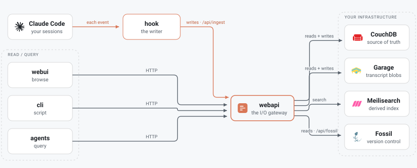

# Architecture

Claude Code keeps transcripts per machine, where they are easy to lose and hard to
search across. Claude Transcripts records every session into stores you run and serves
it back to people and agents. The long-term aim is for Claude Code itself to be the
main reader, recalling and learning from past sessions; that is why the transcript is
kept whole rather than summarised, and why documents are append-only.

Scope is Claude Code only, not agent sessions in general
([ADR 0010](decisions/0010-claude-code-specific-scope.md)).

## Data flow

- **The hook writes, through the webapi.** `claude-transcripts hook run`, registered
  with Claude Code, sends events, chunks, the end-of-session summary and the transcript
  to the webapi's `/api/ingest/*`
  ([ADR 0016, amendment 2](decisions/0016-webapi-is-the-io-gateway.md#amendment-2-the-hook-writes-through-the-webapi)).
  It never blocks a session, and it fails loudly: the banner and statusline say when a
  write is not landing, and `backfill` recovers the gap from Claude Code's own transcript.
- **The webapi is the gateway.** The hook, the webui, the CLI and agents read only
  through it, and write only through its curated routes (`/api/ingest/*`, `/api/migrate/*`,
  `/api/search/reindex`). It proxies CouchDB (`/api/couch`) and S3 (`/api/s3`)
  read-only, because their native APIs are useful read surfaces; writes are never
  proxied. Its API is the stable contract while internals change
  ([ADR 0016](decisions/0016-webapi-is-the-io-gateway.md)).
- **Derived state follows CouchDB.** The webapi follows CouchDB's `_changes` feed to
  keep the search indexes and its in-memory session index current, so every write —
  from whichever ingest route — becomes searchable on one path.
- **Provisioning** (`install`, `provision`) creates databases and buckets directly, on
  the stack it brings up. `setup` touches no store: it writes a client config naming
  the webapi.

## Where things run

- **Client side, on each machine that runs Claude Code:** Claude Code, the plugin
  (`hooks/`, a shim that pipes every hook event to `claude-transcripts hook run`, plus
  skills and the statusline), the hook, and the CLI. Each of them reaches the
  server only through the webapi; none opens a store.
- **Server side:** the webapi, the webui it serves, and the stores (CouchDB, Garage,
  Meilisearch, Fossil). They run as a Compose stack, a Kubernetes base or Helm chart, or
  all in one omnibus container ([distributions.md](../reference/distributions.md)).
  Any store can instead be one you already run
  ([ADR 0020](decisions/0020-bundled-services-default-no-auth.md),
  [ADR 0028](decisions/0028-external-vs-bundled-meilisearch.md)).
- **GitHub:** CI runs on GitHub Actions. A release publishes the app and omnibus images
  and the Helm chart to GHCR, and the CLI as self-contained binaries on GitHub Releases,
  which `install.sh` fetches; the same binary ships inside the app and omnibus images.
  The landing page and these docs deploy to GitHub Pages.

## Components

| Component | Path | Role | Reference |
|-----------|------|------|-----------|
| hook | `packages/cli/src/hook/`, plugin shim in `hooks/` | The writer | [hook.md](../reference/hook.md) |
| webapi | `packages/webapi/` | Gateway; applies migrations on boot; serves the SPA, docs and CLI binary in production | [webapi.md](../reference/webapi.md) |
| webui | `packages/webui/` | Optional React SPA | [webui.md](../reference/webui.md) |
| CLI | `packages/cli/` | Installer, admin tool, terminal client, and the hook | [cli.md](../reference/cli.md) |
| shared | `packages/shared/` | The blueprint, migrations, cross-cutting types, `sumTranscriptTokens` | [webapi.md](../reference/webapi.md#packagesshared) |
| plugin | `hooks/` | Skills, status command, statusline for Claude Code | [plugin.md](plugin.md) |

**The blueprint** (`packages/shared/src/blueprint/`) is the central description of the
system: services and ports, stores, hook events, actions and bindings, routes, env
schema, the CLI spec. It is built from `config/` and the environment, served at `/` and
`/api/blueprint`, and projected into Compose files, the k8s base, the plugin's
`hooks.json`, the architecture diagram and the CLI reference.

## Storage

| Store | Holds | If removed |
|-------|-------|-----------|
| **CouchDB** (core) | `event`, `summary` and `chunk` docs; full-content chunks carry the parsed, pruned turns ([couchdb.md](../reference/couchdb.md)) | Not allowed: it is the source of truth |
| **S3**, bundled as [Garage](https://garagehq.deuxfleurs.fr) (`features.s3Blobs`) | `<bucket>/<sessionId>/transcript.jsonl` (byte-exact, its only home, [ADR 0014](decisions/0014-transcripts-live-in-s3-only.md)) and `summary.json` | No byte-exact transcript; CouchDB keeps the pruned turns |
| **Meilisearch** (`features.meilisearch`) | Derived search indexes over session metadata and turns, rebuildable with `reindex` | No search, nothing else changes |
| **[Fossil](https://fossil-scm.org)** | Version-controlled repositories with a web UI; read through `/api/fossil`, not yet written ([ADR 0031](decisions/0031-fossil-as-bundled-infrastructure.md)) | Nothing today |

The webapi and CouchDB are the only required parts. The webui, CLI, S3 and Meilisearch
are optional, and losing one loses only its feature. S3 is reached through
`Bun.S3Client`, so Garage, MinIO, R2 or AWS work by changing the environment
([ADR 0003](decisions/0003-vendor-neutral-s3-drop-minio-and-rclone.md)). Why these
technologies: [database-choice.md](database-choice.md).

## Session lifecycle

1. `SessionStart` resets per-session state, probes the webapi, writes an event doc,
   prints the banner (whether and where it is recording, the session's link, the Claude
   Code hook-spec check) and injects the recall primer.
2. Each prompt, tool call and stop writes an event doc; the transcript is tailed into
   `chunk` docs every 200 entries or 15 s ([mid-flight-chunking.md](mid-flight-chunking.md)),
   so a live or crashed session can be read.
3. `SessionEnd` flushes the last chunk, writes `summary:<id>` with counts and token
   usage, and uploads the transcript (through the webapi, to S3).
4. A session that never reaches `SessionEnd` (killed, crashed) is finalised later:
   the webapi's change follower runs `claude-transcripts reconcile` on it, which writes
   the missing summary from the recorded events ([tools.md](../operate/tools.md#reconcile)).

Status is derived: `ended` once the summary exists (unless it was reconciled and the
session has recorded activity since), otherwise `running` within
`system.sessions.liveWindowMs` (2 h) of its last activity and `incomplete` after.
Active duration excludes gaps longer than `system.sessions.idleThresholdMs` (5 min).

## Tiers

Three tiers, each a superset of the one below and none allowed to break it
([ADR 0015](decisions/0015-tiered-architecture.md)):

- **Tier 1 (current)** — one machine, one user. Durable capture, browse and search,
  programmatic access. No auth: the bundled services bind to localhost and need no
  credentials from you, except CouchDB's default admin
  ([ADR 0020](decisions/0020-bundled-services-default-no-auth.md)). Its exit gate, an
  end-to-end suite that fakes Claude Code sessions, is in place
  ([testing.md](../develop/testing.md)).
- **Tier 2** — make history useful to future sessions: recall during live sessions
  (started, [plugin.md](plugin.md)), learning from past sessions, analytics,
  attribution across machines and users.
- **Tier 3** — multiplayer and public release: CouchDB replication between instances
  (which the append-only document model is designed for), auth, hook-drift checks in
  CI.

What is planned within each: [roadmap.md](roadmap.md).

## Stack

[Open the diagram on its own](../assets/architecture-stack.html); it follows your light or dark theme.

Bun + TypeScript (ESM, strict) throughout, in one workspace
([ADR 0004](decisions/0004-bun-monorepo-hook-as-standalone-plugin.md)). webapi: Hono,
`@hono/zod-openapi`, `nano`. webui: React 19, Vite, MUI, TanStack Router and Query. CLI:
Ink. API clients are generated from the OpenAPI spec with orval
([ADR 0019](decisions/0019-openapi-source-of-truth-generated-clients.md)). Biome and
lefthook. Releases on GitHub Actions to GHCR and GitHub Releases
([releasing.md](../operate/releasing.md)).
